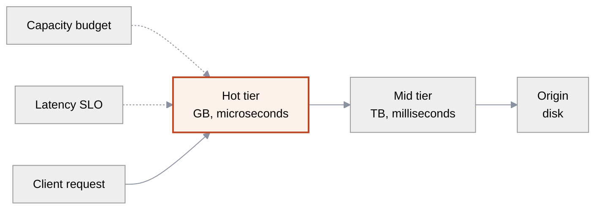
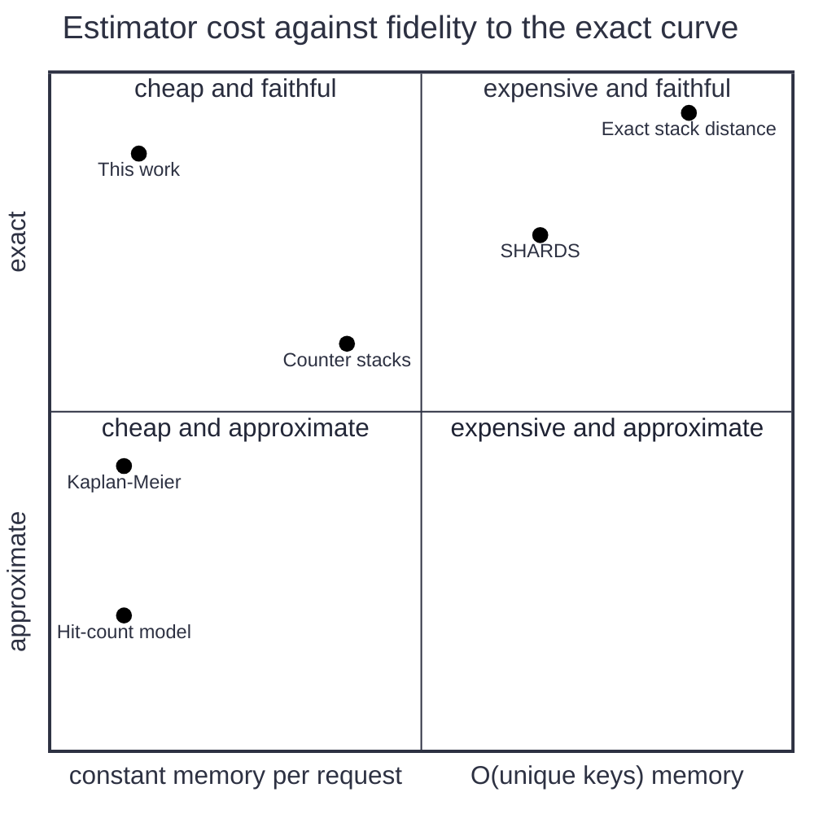
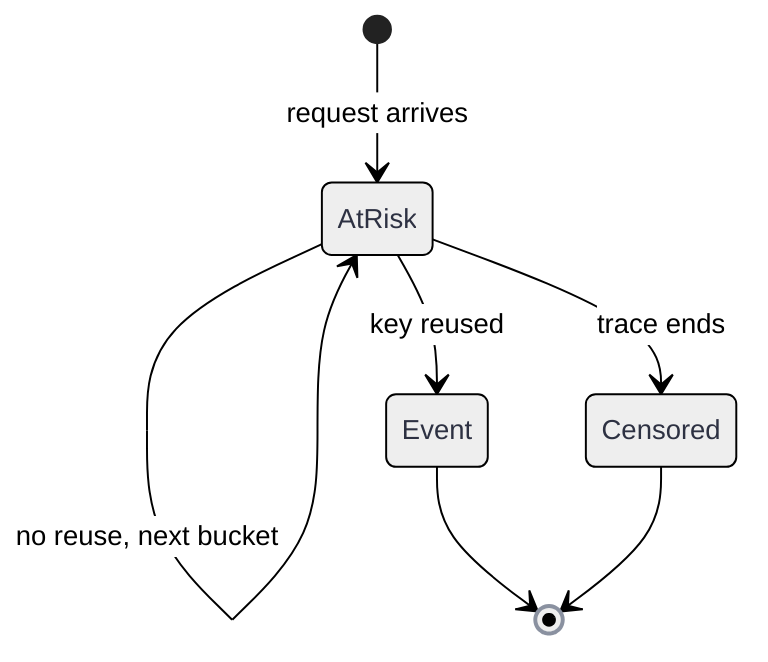
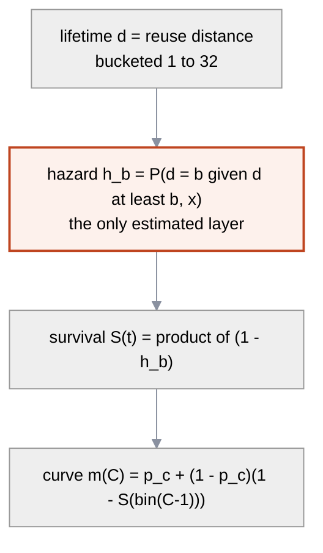
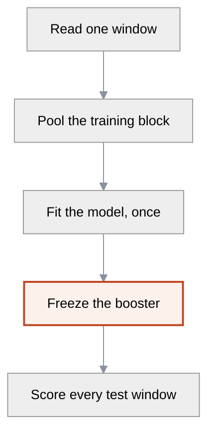
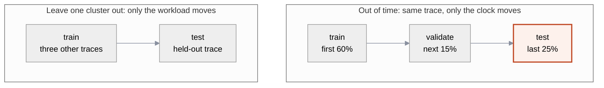

# Guessing the cache miss ratio before you buy the cache

*A hazard model that predicts a miss-ratio curve from request metadata, checked against exact
replay on four production traces, 699 held-out windows.*

---

## 1. The problem is a purchase order

Someone has to decide how many gigabytes the cache tier gets. That decision is made weeks
before the traffic that will fill it exists, and it is expensive in both directions.

Too small, and the miss ratio climbs. Because a cache hit is served in microseconds and a miss
walks to the next tier in milliseconds, the miss ratio is not a gentle cost. Past a knee it is
a latency cliff, and the p99 of the whole service goes with it.

Too large, and you have bought memory that the database or the analytics job needed. Capacity
is not free even when it is cheap, because it is a slice of a fixed budget.

So the question is not "does caching help". It is "what is the miss ratio at each capacity, on
*this* workload, before I commit". The object that answers it is a curve, and this post is
about measuring that curve cheaply and honestly.

*Figure 1. The capacity decision sits between a request path and a budget. Everything else in
this post is an attempt to answer the question on the hot tier.*

## 2. The miss-ratio curve

Hold the workload fixed and vary the cache size. For every capacity $C$, measure the fraction
of requests that miss. That function is the miss-ratio curve, written $m(C)$.

For a fully associative cache with least-recently-used replacement, $m(C)$ has a clean
definition that needs no simulation. Give each request its **reuse distance** $R$: the number
of *distinct* keys touched since the last time this key was requested. A cache that keeps the
last $C$ distinct keys holds exactly the keys whose reuse distance is below $C$. So:

$$
m(C) = \Pr(R \ge C)
$$

Read it once and it is obvious; read it twice and it is the whole post. The hit condition is
an inequality on a single per-request number, which means the curve is the *tail* of the
distribution of $R$. Predicting a curve is therefore predicting a distribution, not fitting a
line through points.

Two properties follow, and both matter later.

**It is monotone.** More capacity cannot create misses.

**It flattens at a floor $p_c$.** A request whose key has never been seen cannot hit at any
capacity. That floor is the compulsory miss fraction, and no model should try to explain it
away.

{{MER:curves}}

*Figure 2. The measured curves for four production traces, sampled at nine shared capacities
because the traces have different grids (12 points for cluster10, 24 for the others). Each point
is the nearest capacity that trace's own grid contains, not an interpolation, and a trace held at
its last value beyond its largest capacity has simply saturated. The y axis is the miss ratio, so
lower is better. The x axis is categorical, since Mermaid charts have no log scale, so read the
shape and the ordering rather than the slopes between ticks. cluster10's curve is flat past
capacity 12, which is the fact that makes its later numbers look different.*

The shape is the point. Between 10 and 10,000 objects the curves move steeply; past a few
hundred thousand they are nearly flat. A cache bought on the flat part is money spent on
nothing, and a cache bought on the steep part is a latency incident waiting for Friday.

{{TBL:curves}}

*Table 1. Curve shape per trace: the miss ratio at capacity 1, the compulsory floor, and the
capacity needed to reach 80 percent of whatever hit ratio the workload can ever achieve.*

{{TBL:cost}}

*Table 2. The same information as a sizing decision, with capacity interpolated in log space
between grid points. For each trace, the capacity needed to reach 60, 80 and 95 percent of the
achievable hit ratio, under the model and under Kaplan-Meier. The last column is Kaplan-Meier's
capacity over the model's: at 0.47 for cluster45, a decision made on the covariate-free curve
buys about twice the memory for the same hit ratio.*

## 3. Why an engineer should care, and what is hard about it

Three uses, in descending order of how often they come up.

**Sizing.** One number per tier, per workload, per quarter.

**Tiering.** If a hot tier and a mid tier split a budget, the split is chosen by comparing two
curves' slopes, not by comparing two averages.

**Regression detection.** A curve moves before a dashboard does. A change in the operation mix
or the key population shows up as a shifted curve while the mean latency is still inside its
noise band.

The hard part is that the honest measurement is a full replay. Exact stack distance needs the
entire trace in memory and one pass per capacity. For a 13.4 billion request trace that is a
real cost, and at design time the trace does not exist yet: you have *today's* workload and a
question about *next month's*.

## 4. What has been tried

The literature splits on one axis: what the estimator costs, and what it can promise.

| approach | what it assumes | what it costs | what it cannot do |
|---|---|---|---|
| Exact stack distance (Mattson, 1970) | nothing | one full pass, $O(U)$ memory for $U$ unique keys | run before the trace exists; run per capacity |
| SHARDS | uniform hashing behaves like sampling | many passes with bounded memory | recover exact per-request distances |
| Counter stacks | a small counter array approximates the stack | counter memory per sample | give an exact curve at large capacity |
| Simulation (Talus, libCacheSim) | a cache simulator is faithful | a simulated run per capacity | predict for a policy you did not simulate |
| Kaplan-Meier on reuse distance | the distance distribution is what matters, covariates are not | one pass, no memory | use metadata to separate workloads |
| Learned frequency models | frequency is a proxy for distance | one fit | survive the frequency to distance conversion |
| **This work** | the hazard of reuse is a function of cheap per-request metadata | one fit, then a prediction per window | guarantee in-domain accuracy on an unseen trace |

*Table 3. Where this method sits. The comparison axis is estimator cost against fidelity, not
accuracy alone.*

*Figure 3. The same comparison as a picture. The axis labels are qualitative: only this work's
position is backed by a measurement here, and the others are placed from what each method can
promise, not from a benchmark run in this repository.*

The last row is the contribution and it is deliberately narrow: the survival-function view of
the curve, a discrete hazard with an explicit censoring correction, covariates drawn from
request metadata, and an evaluation that holds out whole windows and whole traces. This is not
the first learned miss-ratio estimator, and the post does not claim that.

## 5. The data

Four traces from the CMU mirror of the Twitter cache traces. A **cluster** here is one
production cache front-end: an anonymized service whose requests were logged in time order and
published as a sorted CSV of `timestamp, key, key_size, value_size, client_id, operation, ttl`.
Fifty-four clusters are published. The object size the cache model uses is `key_size +
value_size`.

Four of them, chosen for contrast:

- **cluster52** is the large one: 13,426,570,607 requests over 6.41 days, 93.09 GB compressed,
  about 24,229 requests per second, mean 48.6 bytes per request.
- **cluster10, cluster26, cluster45** are small shards, 1.0 to 1.7 GB compressed, used for
  development and for the cheap experiments.

Why four and not one: the transfer question needs traces that differ. They do, by orders of
magnitude.

{{TBL:traces}}

*Table 4. Measured distribution per trace, from the label cache each experiment reads. Cold
fraction is the share of requests whose key was never seen before, which sets the floor $p_c$
in Figure 2. The p99 reuse distance spans roughly four orders of magnitude across these four
traces, so "does the model transfer" is not a small perturbation test.*

One trace needs a warning before its numbers are read. cluster10 has extremely short reuse:
half its requests are first accesses, and 99 percent of the rest are reused within 8 distinct
keys. Its curve is essentially saturated at a capacity of five objects, so it is a useful test of
whether the model stays accurate on a nearly flat curve, and it is not representative of a large
cache. The three other traces span the interesting range.

The operation mix matters more than it looks. Almost nine requests in ten are reads, and `ttl`
is zero for every read and set for every write. A model that treats raw `ttl` as a number sees
a spike at zero that is really the operation column, so the feature is a TTL category plus an
explicit `is_write` flag.

## 6. The model: reuse as a lifetime

The curve is a tail probability, so model the distribution directly. Survival analysis is the
branch of statistics built for exactly that, and its vocabulary maps onto this problem without
a metaphor.

**An episode.** Each request opens an episode: the interval until the same key is requested
again. The length of that episode is the reuse distance $R$ of the next access. One episode per
request, millions of episodes per window.

**Censoring.** Some episodes never close inside the trace. The key was requested and then not
seen again before the log ends, so we know it survived past that point and we do not know how
long after. That is **right censoring**, and it is information, not missing data: it says the
reuse distance is *at least* this large.

*Figure 4. One episode. Censoring is a third outcome beside "reused" and "never seen before",
and it is the outcome a naive regression has to throw away or invent a label for.*

**Discretization.** Split the distance axis into $K = 32$ log-spaced buckets. Buckets rather
than exact values, because the tail is four orders of magnitude long and a smooth model over
32 bins is easier to regularize than a model over $2^{21}$ distances.

Now the central quantity. For bucket $b$ and feature vector $x$:

$$
h_b(x) = \Pr(d = b \mid d \ge b,\; x)
$$

This is the **discrete hazard**. Read the condition carefully, because it is what makes the
model correct. It asks: given that this episode has *already survived* to bucket $b$, what is
the chance it ends here? Every quantity is conditioned on the state the episode is actually in.

**Survival is a product.** To still be open after bucket $t$, the episode must have failed in
none of the buckets up to $t$:

$$
S(t \mid x) = \prod_{b \le t}\bigl(1 - h_b(x)\bigr)
$$

A product and not a sum, because each bucket's hazard is conditional on having reached it. The
events are chained, so their probabilities multiply. This is the same identity that makes
survival analysis work in medicine, and it is the same reason a Kaplan-Meier curve is a running
product of one-minus-hazard.

**The curve is a read-off.** Put the pieces together:

$$
m(C) = p_c + (1 - p_c)\,\bigl(1 - S(\mathrm{bin}(C-1) \mid x)\bigr)
$$

The second term is the probability that a request could have hit but did not survive to the
capacity bucket. The $p_c$ term is the compulsory floor from Section 2: a first access cannot
hit at any capacity, so it sits outside the survival product rather than inside it. Get that
term wrong and the curve is wrong at every capacity by a constant.

*Figure 5. The four layers. Nothing downstream is learned: once the hazard is estimated, the
survival product and the curve are arithmetic.*

{{TBL:symbols}}

*Table 5. Every symbol used above, with its domain. There are ten of them and no others are
needed.*

**Where the censoring correction actually lives.** Not in the loss, and not in a post-hoc
adjustment. It lives in how the training rows are built. Each episode becomes a set of rows,
one per bucket it was at risk in. The label is 1 only in the bucket where the reuse happened.
A censored episode contributes rows with label 0 up to its censoring bucket, and no rows after
it. That construction is the **risk set**: the denominator at bucket $b$ is exactly the episodes
still alive at $b$, which is precisely the conditioning in $h_b$.

Treat a censored episode as a non-event for all 32 buckets instead, and you inflate the
denominator with episodes that were never observed that long. The hazard comes out too low,
survival too high, and the curve bends upward at large capacity. The bias is systematic and it
has a sign, which is the worst kind. A regression that simply drops censored episodes has the
opposite problem: it keeps only the episodes that closed quickly, which are the popular keys,
so it over-estimates the chance of a small reuse distance.

## 7. Why a survival model and not a regressor

Three arguments, each with a mechanism rather than a preference.

**1. The estimand is a distribution, not a mean.** A regressor trained to predict $R$ minimizes
error on the mean of $R$. The quantity anyone needs is $\Pr(R \ge C)$ at 24 capacities. The
mean of a heavy-tailed variable with mass at infinity is not a useful summary, and a model that
minimizes squared error on it is optimizing the wrong functional.

**2. Censoring has no honest regression answer.** With a regression target, unobserved episodes
are a hole. Fill it by dropping and you select on the outcome. Fill it by imputation and you
invent data. The hazard formulation consumes them exactly: they contribute "no event" rows and
they leave the risk set at the right time.

**3. The bias and variance land in different places.** This is the part that took measuring.
A per-request hazard is a smooth function of twelve features. A flexible learner on millions of
rows will not overfit the *curve*, because the curve averages over a risk set with millions of
members: individual errors partly cancel, and the survival product smooths further. The
capacity knob is `num_leaves`, and the measured in-domain residual is dominated by a signed
level offset rather than shape noise, with $|\text{bias}|/\mathrm{MAE}$ between 0.74 and 0.97
(Table 12). That is the signature of a low-variance, slightly miscalibrated fit, which is the
good failure mode: a scalar could remove most of it, and a scalar is cheap.

So the trade is explicit and it is made in the right place. Take a high-variance learner,
accept that it can be miscalibrated in level, and make the *distribution* the object that gets
averaged. Do not ask one small tree ensemble to be sharp and unbiased at the same time.

## 8. The learner

LightGBM. Concretely: gradient-boosted decision trees over histogram-binned features.

Define the pieces, because the acronyms carry no information.

**Gradient boosting.** Fit a small tree on the errors of the current model, add it with a
shrinkage factor, repeat. Each tree is fitted to the gradient of the loss, which for a binary
logistic loss is the residual between the label and the predicted probability.

**Histogram binning.** Each feature is bucketed once into 255 bins. A split search then costs
$O(\text{bins})$ per feature instead of $O(\text{rows})$. On a design matrix with 20 million
rows and 12 features this is the difference between seconds and minutes per tree.

**Leaf-wise growth.** Trees grow by splitting whichever leaf reduces the loss most, not level
by level. `num_leaves` is therefore the real capacity knob, and 63 leaves is a reasonable
ceiling for this data.

**GOSS** is an optional sampling scheme in LightGBM: keep the rows with large gradients and
subsample the rest. **This project does not use it.** It is worth saying why we did not try
harder: down-sampling the small-gradient rows changes the effective label distribution that
$S(t)$ is read from, and the risk-set construction is the thing that makes the hazard
unbiased. Trading that away for throughput on a fit that already takes a minute is a bad trade.

**Boosting mode.** Plain `gbdt`, no Dart, no random forest mode.

{{TBL:learner}}

*Table 6. Shipped parameters, the ranges the search explored, and what each one controls. The
defaults are what the retrain curve used, where the search was frozen on purpose.*

Two choices deserve a line each. `deterministic=True` with `force_row_wise=True` makes replicate
runs bit-comparable at a small throughput cost, which is what lets a result be re-run and
compared instead of trended. And `min_data_in_leaf=100` matters more than it looks: the last
few buckets are sparse, and a leaf with three rows in a rare bucket produces a hazard estimate
with enormous variance that the survival product then compounds.

## 9. Loss, validation and class balance

**It is a classifier, not a regressor.** The label is binary: did this episode end in this
bucket (1) or not (0). The loss is binary logloss on the expanded table of (episode, bucket)
rows. Early stopping uses validation logloss over 200 to 400 rounds.

**No class weighting is applied.** No `scale_pos_weight`, no `is_unbalance`. The label is rare
per row, since each episode contributes one event row to 32 rows of "not yet", but re-weighting
would be wrong here. Predicted probability *is* the quantity the curve integrates: $S(t)$ is a
product of $1 - h_b$, so multiplying the event class to balance the rows would shift every
hazard upward and bend the curve at every capacity. The imbalance is a property of the expanded
table, not a defect of the sample.

One caveat stays on the record. The loss averages over *rows*, and rows are not independent:
32 rows share one episode. So the loss's implicit weighting is not the deployment weighting,
which is per request. We did not correct for it, and the measured level offset (Section 13) is
consistent with the model being slightly conservative, but that link is an inference and not a
measured mechanism.

**Validation is a block, not a fold.** The split is time-ordered: train, then validation, then
test, each contiguous. Shuffling requests across time would leak the future into the fit, and
the entire point is to predict a period that did not exist at fit time.

## 10. Hyper-parameter search

Optuna, with the tree-structured Parzen estimator (TPE) sampler.

Why not grid search: a grid costs the product of the axes. With six axes at five values each
that is 15,625 fits, and it spends most of them in regions that are obviously bad. Why not
random search: it is a fine baseline, it does not waste runs on a lattice, and in high
dimensions it beats a grid. But it learns nothing from the trials it has already run.

TPE models the objective's distribution separately for good and bad trials and samples where
the expected improvement is high. It uses its history, which is what a search should do.

**And then a measurement that humbled the method.** At 12 trials, cluster10, cluster26 and
cluster45 returned *identical* chosen hyper-parameters, and the Spearman rank correlation
between their trial-value rankings was exactly 1.000. That is not three traces agreeing. Seeded
TPE spends its first 10 trials on random draws, so at 12 trials the "search" was two informed
trials dressed as a ranking, and what the ranking actually captured was capacity order across
traces.

Continuing the same studies past trial 20 made them diverge per trace (`num_leaves` 24, 20, 25;
learning rate 0.110, 0.104, 0.103) and improved every test MAE: cluster10 from 0.003704 to
0.003637, cluster26 from 0.001762 to 0.001518, cluster45 from 0.001517 to 0.001313. The studies
reported here ran 35, 29, 30 and 20 trials.

The rule we now apply: **a study is reported only if it ran past trial 20.** A study stopped at
10 or 12 trials is random search wearing a sampler's name. That is a general lesson, not a
detail of this project.

{{TBL:optuna}}

*Table 7. Trial counts from the study databases, the best validation-block error each study
found, and the test error after refitting the chosen parameters on the full training block.
The two error columns are different blocks and are not expected to agree: the study optimizes
the validation block, and the last column is the only number that is out of time. cluster52's
study is shorter because its windows are expensive.*

## 11. How it runs

The pipeline is deliberately shaped like the deployment question.

*Figure 6. Read a window, pool the training block, fit once, freeze, then score each test window
independently. The freeze is the contract: no test window is opened before it.*

**Streaming, not sliding, and not expanding.** Windows of 5,000,000 requests are read in time
order from parquet and discarded after their histogram and a sample of rows are taken. Peak
memory is one window plus the pooled training rows, not the trace.

**One frozen fit.** The model is fitted once on a uniform sample of the first 60 percent of the
trace. It is never refit per window, and it is not an expanding-window or online model: the
weights do not move after the fit. This makes the reported numbers a deployment claim rather
than an optimistic one, because nothing in the scoring step has seen the future.

**Two details that keep the claim honest.** The bin grid is derived from the *train block only*,
because at deployment the later periods do not exist. And every score file is invalidated when
it is older than the model file, because a stale score reported under new parameters is a
fabrication with a timestamp.

Cost, measured on this machine: one 5M-request window takes about 12 seconds to read and label,
and a fit takes 30 to 90 seconds depending on the row budget. Scoring is the parallel part, and
it is embarrassingly parallel because each window writes its own file.

## 12. Two validations, two questions

*Figure 7. Out-of-time keeps the trace and moves the clock. Leave-one-cluster-out keeps the
clock and moves the workload.*

**Out-of-time (OOT).** Fit on the first 60 percent, score every window of the last 25 percent.
The trace, the capacity grid and the feature distribution are fixed; only time moves. This
answers the deployment question for a cache you already operate: does this week's model describe
next week.

**Leave-one-cluster-out (LOCO).** Fit on three traces, score every window of the fourth. The
code is fixed and the distribution moves. This answers the new-customer question: can a model
trained on workloads we have seen work on one we have not.

The two are reported together because each alone is misleading. OOT alone says nothing about a
workload you have never measured, and LOCO alone cannot distinguish a model that fails on drift
from one that fails on a different key population.

## 13. Results

### Out of time

{{TBL:oot}}

*Table 8. Every window of the last 25 percent of each trace. MAE is the mean over the 24-point
capacity grid of the absolute difference between predicted and exact miss ratio. The ratio
column divides that by the Kaplan-Meier error on the same windows. `n` is the number of windows,
and it is not decoration: a mean over 7 windows and a mean over 672 are different evidence.*

The model beats the covariate-free floor on **all 699 scored windows** across the four traces,
with no exception. Three of the four are accurate to between 2 and 7 parts in a thousand of miss
ratio.

cluster52 deserves its own sentence, because it is the only row whose test block is a
distribution rather than a handful of windows: 672 of 672 windows, 94 shards, no subsampling.
Its block-bootstrap 95 percent interval on the mean MAE is **[0.003416, 0.004318]**, and its
per-window interquartile range is [0.002122, 0.005872]. The bootstrap resamples contiguous
blocks, not single windows, because neighbouring windows share a working set and an i.i.d.
bootstrap would report an interval that is too narrow.

{{MER:ratio}}

*Figure 8. The same eight rows as one ratio each: model error divided by Kaplan-Meier error. A
bar of 1.0 would mean the covariates bought nothing; every bar here is far below it.*

### Out of distribution

{{TBL:loco}}

*Table 9. Trained on three traces, scored on the fourth. The last column divides the held-out
error by the same trace's own-data error from Table 8.*

Four readings, in order of how much they cost to learn.

**The functional form transfers.** Every fold beats Kaplan-Meier by between 9 and 60 times. On a
trace the model has never seen, it is still a usable predictor of the curve's shape. Nothing
collapses.

**The absolute level does not.** Three of four folds lose about a factor of four in MAE, and the
held-out cluster52 error is 1.63 percentage points of miss ratio, which is enough to mis-size a
cache by a factor. A model trained elsewhere is a good prior and a poor final answer.

**The loss is distributional, not starvation.** The LOCO models were trained on 180 million
requests each, against 83.5 to 120 million for the own-data models. More data produced worse
error on three of four traces. That is a clean argument that the gap is the distribution
shifting, not the model needing more rows.

**One trace inverts, and the retrain curve explains it.** cluster10's held-out model
(0.002756) beats its own-data model (0.003637). That looked like a bug until the retrain curve
(Figure 9) showed cluster10 is still falling steeply when more of its own history is pooled: its
binding constraint is coverage of its own periods, so a broader set of other workloads is a
better prior than the narrow slice it was fitted on. Two independent experiments, one
mechanism.

### How much history a new trace needs

{{TBL:retrain}}

*Table 10. Hyper-parameters frozen with `--trials 0`, the same test windows at every budget, and
the fit row count held fixed at about 3.6 million rows. The axis that moves is therefore the
number of distinct 5 million request windows pooled into the training sample, not the number of
rows fitted.*

That distinction is worth a sentence, because it is easy to get wrong and this experiment got it
wrong first. The pooled sample is capped by a row budget that is divided across the pooled
windows, so adding windows buys *coverage*, not volume. What the curve measures is how much
history the model needs, at constant fit cost. The earlier description of these runs as 5, 25
and 60 million training rows was wrong; the artifact records 2.5 to 3.6 million rows for every
point.

{{MER:retrain}}

*Figure 9. Pooling 12 windows instead of 1 drops cluster10's error by 4.1 times at the same row
count, so the gain is coverage and not volume. cluster26 gains 1.8 times and flattens. The y axis
is thousands of miss ratio, so 4.3 means 0.0043.*

cluster10 is still falling at 12 windows, which is the fact that explains the inversion in
Table 9. cluster45's line is flat, and its three points sit inside its own per-window spread of
0.0007 to 0.0035. That line is a **null result**: this experiment cannot say what cluster45's
history demand is, and it is reported as a null rather than as evidence of saturation.

### What the residual looks like

{{TBL:bias}}

*Table 11. In-domain residual decomposition. Bias is the mean signed error of the curve; a
negative bias means the model under-predicts the miss ratio.*

This is the finding that was not planned. In-domain, the residual is almost entirely a
**constant level offset**: $|\text{bias}|/\mathrm{MAE}$ is 0.74 to 0.97, the sign is negative
every time, and the worst single grid point is only 2.5 to 3.5 times the MAE. The model
under-predicts the miss ratio by 0.1 to 0.4 percentage points, uniformly across capacities.

That matters for two reasons. Practically, the failure direction is under-provisioning, which
is the expensive one. Statistically, a uniform offset is a calibration error and not a shape
error, so a per-trace scalar multiplier would remove most of it. That recalibration is a
hypothesis: it has not been run, and it is the first item on the list of what to do next.

Out of domain the picture changes: for cluster10 and cluster26 the worst grid point is 9 to 10
times the MAE, so the residual is no longer a clean offset. Level calibration is an in-domain
tool, not a general fix.

## 14. Can we train once and keep it deployed

The question behind the question, and the answer has three parts.

**For a cache you already run: yes, with eyes open.** Out-of-time error is 0.2 to 0.7 percent
of miss ratio on three traces and holds on every window. The model needs no retraining to stay
useful across the measured horizon, which is the last 25 percent of each trace.

**For a cache you have never measured: no, not on its own.** Beats the floor on every window,
loses about a factor of four in absolute accuracy. Use it to plan the first week, then collect a
few tens of millions of requests, refit, and re-tune.

**Drift will show up as bias first.** Since the in-domain residual is a level offset, a
monitoring rule that watches the mean signed error of the curve is more sensitive than one
watching the shape. That is a design implication of Table 11 and it is testable, which is more
than a generic "monitor for drift" sentence.

## 15. What we got wrong

Three retractions. They are here because a results section without them is a sales document.

{{TBL:retract}}

*Table 12. Claims that were wrong, the mechanism that made them wrong, and what replaced them.*

The pattern across all three is the same: the failure was in the measurement harness, not in the
model. A study that stops before its sampler starts, a cache that validates on the wrong file's
timestamp, a baseline that reads the answer. Each one produces a plausible number, which is
exactly why each one had to be caught by an experiment rather than by review.

## 16. Limitations

**LRU only.** The curve is defined by LRU hits. A real cache runs an eviction policy with
admission and a probabilistic eviction (S3-FIFO, TinyLFU, and friends), whose miss ratio is not
$m(C)$. Using this curve for that policy is an approximation with no measured error bound here.

**Object capacity, not bytes.** The code can do a byte-weighted curve, and the four traces here
are reported in objects. A byte curve is what a provisioning decision actually wants.

**One corpus.** Four traces from one mirror of one service. The pattern across them is
informative, and it is not evidence about storage, CDN or database workloads.

**A fixed censoring convention.** Episodes are censored at the trace boundary. A streaming
deployment censors at the point of prediction, which is a different (and shorter) horizon.

**32 buckets.** The top bucket merges every distance beyond the cap. The curve is therefore
exact only below that cap, and the cap is set from the train block's p99.9.

**No online adaptation.** The model is frozen after the fit. Section 14 recommends retraining,
which is a schedule, not a method.

## 17. Conclusion

The curve is a tail probability, so model it as one. A discrete-time hazard over the reuse
distance, with covariates from request metadata and censoring handled in the risk-set
construction, predicts the miss-ratio curve on every one of 699 held-out windows and beats the
covariate-free floor on all of them. Trained on other workloads it still beats the floor, but
loses about a factor of four in absolute accuracy, which is the honest boundary of the claim:
the method transfers, one set of weights does not.

The two findings worth carrying forward are both about where the error lives. In domain it is a
level offset, not shape noise, which makes a scalar recalibration the obvious next experiment.
And the search was a startup artefact until it ran past trial 20, which is a rule about
reporting rather than a fact about Optuna.

{{TBL:repro}}

*Table 13. Reproduction, in order. Every number in this post comes out of the artifacts these
commands write; the post itself is generated by the last one.*

---

### Notes on this post

Every figure is Mermaid source inside this file, so the post is one plain markdown file that
renders on GitHub, in Obsidian, or in any Mermaid-aware viewer, and every diagram is editable
text. The three data charts and every table are generated from the same artifacts by
`scripts/blog_build.py`: a number in this post that no artifact supports cannot appear, because
it would have to be typed by hand and the build does not type numbers. The companion wiki pages under `wiki/docs/` carry the full tables, the per-window
files and the retracted values.
